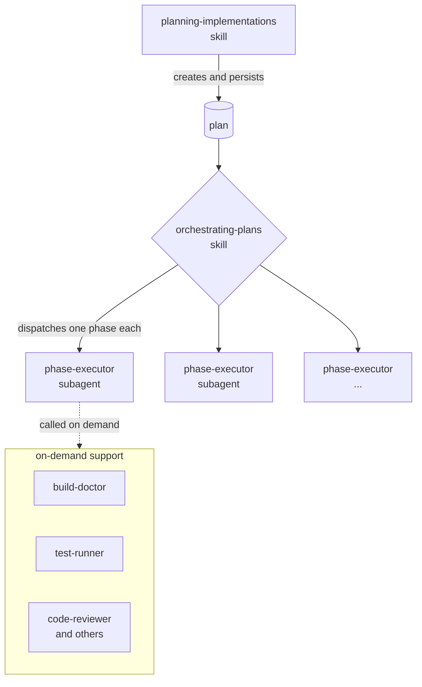

# Softchestrate
[](https://github.com/Laragear/Softchestrate/actions)


A baseline library of subagents and skills to orchestrate software work with fewer tokens spent.

- **Pay for the work, not the conversation.** Each task goes to the narrowest subagent in a fresh context, so you only spend tokens on the role that actually does the job.
- **Proof before reports.** Definitions verify their own output — containers that build, migrations that reverse, deploys that pass health checks — before claiming success.
- **No model hard-wired.** A `complexity` tier per definition plus dispatch-time model assignment lets any harness pick the cheapest model that fits the task.



> [!TIP]
> 
> Skills change _how_ you work, subagents change _who_ does the work. When a task fits a narrower agent, dispatch it instead.

## Become a sponsor

[](https://github.com/sponsors/DarkGhostHunter)

Your support allows me to keep this package free, up-to-date and maintainable. Alternatively, you can **[spread the word!](http://x.com/share?text=I%20am%20using%20this%20cool%20agent%20library&url=https://github.com%2FLaragear%2FSoftchestrate)**

## Requirements

- An agent harness with native subagent and skill discovery (Claude, Codex, Cursor, OpenRouter, ZCode, to name some).
- MCP support for tool access. It is not required, since every definition falls back to plain search and file reads when a capability is missing.
- [Node.js](https://nodejs.org) 22.20 or later for the skills CLI. The agents script only needs `sh`, `tar` and `curl` or `wget`.

Almost all modern harnesses support subagents, skills and MCP tools. If not, check its configuration.

## Installation

You never need to clone this repository. The skills go in with the [skills.sh](https://skills.sh) CLI, which installs them into the discovery path of every agent harness it detects:

```bash
npx skills add Laragear/Softchestrate
```

By default it asks which skills and harnesses to use. Add `--all -y` to install everything without questions, or `-g` to make the skills available across projects. Run the command again to update the installed skills.

The skills CLI only distributes skills, so the subagents go in with a small copy-only script:

```bash
curl -fsSL https://raw.githubusercontent.com/Laragear/Softchestrate/1.x/install-agents.sh | sh
```

It copies `agents/` into `~/.agents/agents` and makes the installed files identical to the repository versions on every run. Files that are already equal are left untouched, and anything else in the target directory is never deleted.

> [!WARNING]
> 
> The script **overwrites** the installed files without asking. Adapt the copies elsewhere, or your changes will be gone on the next update.

| Option | Effect |
| --- | --- |
| `--dry-run` | Reports what would change and writes nothing. |

Environment variables: `SOFTCHESTRATE_REF` installs a tag or commit instead of `1.x`, `SOFTCHESTRATE_HOME` installs somewhere other than `~/.agents`, and `SOFTCHESTRATE_SOURCE` installs from a local checkout.

#Note: `investigating-with-evidence` borrows its subagent sizing, brief and notes format, lookup budget, source weighing and report discipline from Anthropic's `deep-research` skill.

## Adapting to your harness

Neither installer configures any harness. Skills follow the Agent Skills spec, so a harness that supports it loads them directly, and you tune model and effort at dispatch time as described in [Assigning models](AGENTS.md#assigning-models).

Subagent definitions need translating into whatever the harness records, so ask it to adapt them: "Adapt the Softchestrate subagents in `~/.agents/agents` to this harness, following AGENTS.md." Write the adapted copies to the harness's own discovery paths and leave the files in `~/.agents/agents` as they are.

After each update, adapt again the files the installer reports as installed or updated. To use the baselines in a single project only, run `npx skills add Laragear/Softchestrate` inside it, which defaults to a project install, and bring the subagents with `SOFTCHESTRATE_HOME=<project> sh install-agents.sh`.

### Letting your agent install it

If your agent can run shell commands, say "Install Laragear/Softchestrate". The agent should:

1. Run `npx skills add Laragear/Softchestrate` and follow its prompts, or `npx skills add Laragear/Softchestrate --all -g -y` when you want everything installed globally without questions.
2. Download `install-agents.sh` from the raw URL above to a file, and read it.
3. Run that file with `sh <file> --dry-run`, show you the report, and run `sh <file>` when you agree with it.
4. Adapt the subagent definitions in `~/.agents/agents` to this harness, as described above.

## How does it work?

Everything here is a platform-neutral source definition. An agent is a single Markdown document: a frontmatter with a `name`, a `description` and an optional `complexity`, one of five words, followed by the system prompt. A skill is a `SKILL.md` in a folder of the same name, with a frontmatter of `name`, `description` and an optional `license`, plus `references/` or `scripts/` when it needs templates or checks loaded on demand.

Nothing in the files points to a model, a provider or a harness. Baselines describe *what* to do and *when*, never *where*. The harness you import them into supplies the runtime: model, reasoning effort, tool access and permissions. The [baseline rules](AGENTS.md) govern imports and dispatches. The `complexity` tier is a suggestion about what kind of work a definition does, not a model assignment: the harness picks the cheapest model that can handle each task, as described in [Assigning models](AGENTS.md#assigning-models).

> [!IMPORTANT]
> 
> Treat imported baselines as read-only. Tune the runtime, not the baseline.

## The subagents

Ten agents, each with one role. Choose the narrowest role that fits, or skip the dispatch entirely. The complexity column is a suggestion, not a model choice.

| Agent | Complexity | Description |
| --- | --- | --- |
| `build-doctor` | judgment | Diagnoses failing builds, dependency installs and boot errors, and returns ranked root causes. |
| `code-explorer` | routine | Locates code with read-only fan-out searches and returns conclusions with `path:line` references. |
| `code-reviewer` | judgment | Reviews completed changes against repository conventions and a fixed quality checklist. |
| `codemod-runner` | mundane | Applies one fully specified mechanical change across many files, exact match only. |
| `fixture-factory-generator` | routine | Generates factories, seeders and typed fixtures from existing schemas. |
| `general-purpose` | judgment | Handles research, search and multi-step tasks when no narrow role fits. |
| `lint-static-analysis-fixer` | mundane | Runs formatters, linters and static analyzers and applies only their automatic fixes. |
| `phase-executor` | interpreting | Executes exactly one phase of an approved plan and tracks it in a durable manifest. |
| `security-auditor` | judgment | Finds exploitable security flaws in code and reports each as a testable claim with evidence, for `disproving-audit-findings` to test. |
| `test-runner` | interpreting | Runs tests or coverage, reports grouped results and hands structural fixes back as change specs. |

## The skills

The complexity column is a suggestion, as for the agents.

| Skill | Complexity | Description |
| --- | --- | --- |
| `creating-devcontainers` | judgment | Builds and verifies a DevContainer from repository evidence, matching the host UID and GID. |
| `deploying-builds` | critical | Deploys, ships, releases, publishes or rolls out a build to a detected destination and verifies the live result. |
| `disproving-audit-findings` | judgment | Tests code review and audit findings with reproduction tests and reports which are false positives. |
| `investigating-with-evidence` | judgment | Runs source-traced investigations that end in a checkable report. |
| `migrating-schemas` | judgment | Writes reversible schema and data migrations that stay safe on live rows, and never runs them. |
| `orchestrating-plans` | critical | Softchestrates an approved plan by scheduling phases and gating their returns. |
| `planning-implementations` | critical | Creates, revises and resumes technical implementation plans. |
| `refactoring-code` | judgment | Restructures existing code to be smaller and simpler without changing behavior. |
| `replicating-production-locally` | judgment | Builds a local replica of the decided production architecture so changes can be tested safely. |
| `upgrading-dependencies` | judgment | Moves one package or framework to a new version, maps its breaking changes to the code and verifies the result. |
| `writing-documentation` | interpreting | Writes and edits documentation grounded in the code, with a fixed voice. |
| `writing-expressive-code` | interpreting | Names and structures class, module and API members with a fixed verb vocabulary, and owns doc-comment and method-size rules. |

### It's working if

One observable signal per definition, to check an import or a run against.

- `build-doctor`: a red build returns one ranked root cause with log evidence and a one-line fix, or `STATUS: HYPOTHESES` after its bounded runs, never a raw log dump.
- `code-explorer`: the answer arrives as conclusions with `path:line` references and explicit "not found in X" statements, not file dumps.
- `code-reviewer`: findings arrive severity-ranked with evidence, spec findings in their own section, and nothing outside the checklist or the spec.
- `codemod-runner`: the after-census reconciles exactly, so every in-scope match is edited, skipped with a reason, or excluded.
- `fixture-factory-generator`: generated files imitate the repository's existing factories and never invent a field the schema does not have.
- `general-purpose`: the report opens by restating the objective and the done condition, then answers with evidence for every claim.
- `lint-static-analysis-fixer`: every command and exit code is reported, only tool-mandated or closed-list fixes landed, and the rest comes back UNFIXABLE with reasons.
- `phase-executor`: the manifest shows a terminal status with evidence for every instruction, and the report matches it step for step.
- `security-auditor`: every finding is a claim a test could refute, with the input-to-sink path and the missing control named.
- `test-runner`: failures come back grouped by root cause, chore fixes verified by a re-run, and structural issues as self-contained handback specs.
- `creating-devcontainers`: the container builds, the ownership probe matches the host UID and GID, and every VERIFY line is PASS with evidence.
- `deploying-builds`: the live version is pinned to the artifact hash, health checks pass, and nothing state-changing ran before the gates.
- `disproving-audit-findings`: every finding ends as Confirmed, False positive or Not testable, each backed by a reproduction test someone reviewed.
- `investigating-with-evidence`: every claim in the report carries a verbatim quote and a footnote a reader can open.
- `migrating-schemas`: every migration names its release, its reverse path or why none exists, and its per-statement lock risk.
- `orchestrating-plans`: phases land collision-free: each gate reconciles the manifest, the report, the actual diff and the acceptance criteria before any commit, and no second plan starts while `executing/` holds one without the user's choice.
- `planning-implementations`: an executor with no chat history can run the plan, every acceptance criterion has a check, a runner and a seam, and a plan that has not started executing waits in `pending/`.
- `refactoring-code`: tools and tests are green, behavior and public API are identical, and the result is indistinguishable from the surrounding code.
- `replicating-production-locally`: one command starts the replica and one tears it down, with every component row carrying `path:line` evidence and its gaps.
- `upgrading-dependencies`: every breaking change between the versions is applied, recorded as `not used`, or deferred with a reason.
- `writing-documentation`: every sentence is grounded in code that exists, in the fixed voice, with no invented defaults.
- `writing-expressive-code`: new names come from the verb dictionary and every non-trivial choice closes with a `decision ← source` trace.

## Adapting to your harness

Copy the files into the discovery paths the harness reads, then translate the frontmatter into whatever it records. The `name` and `description` map to the listing and dispatch metadata, and the body stays verbatim.

```yaml
---
name: "build-doctor"
description: "Diagnoses why a build, compile, dependency install, ..."
complexity: "judgment"
---
```

`complexity` is an optional top-level field, one of five words from `mundane` to `critical`, defined in [the subagents spec](https://personal-f2f22caf.mintlify.site/specification) and tabled in [AGENTS.md](AGENTS.md#the-complexity-key). Skills carry none. It is tempting to bake a favorite model into the baseline. Do not, because the next harness may not have it.

Treat `complexity` as a suggestion, not a rule. The harness should evaluate each task and pick the model and effort for it, using the tiers described in [Assigning models](AGENTS.md#assigning-models). A `critical` definition whose current task is a bounded procedure may not need the top tier, while a `judgment` security audit may need only a strong one. If the harness has no data on its models, it should look up their capabilities and prices before assigning anything. Usage is the cost to avoid: mundane tasks should not burn the most expensive model.

Map the capabilities an agent requests to the tools the target environment has, with MCP servers where supported. Read-only agents (`code-reviewer`, `build-doctor`, `code-explorer`) should be limited to read tools in the harness, not only in prose. Where the harness lets you keep a skill from being started by the model alone, do it for `deploying-builds`, since it changes live state. Make runtime adaptations in the harness's native configuration; modify a baseline only when the baseline itself is what you were asked to change.

## For maintainers

`references/` holds the researched guidance these definitions follow (Agent Skills spec, vendor docs, papers, expert and community notes), with an index at [`references/INDEX.md`](references/INDEX.md) and an audit checklist at [`references/rules.md`](references/rules.md). It is not copied into harnesses. Every behavior change to a baseline gets one entry in the [CHANGELOG](CHANGELOG.md), so an installed copy can be compared against it when deciding what to re-import.

## Security

If you discover any security-related issues, please [use the online form](https://github.com/Laragear/Softchestrate/security).

# License

This specific package version is licensed under the terms of the [MIT License](LICENSE.md), at the time of publishing.
